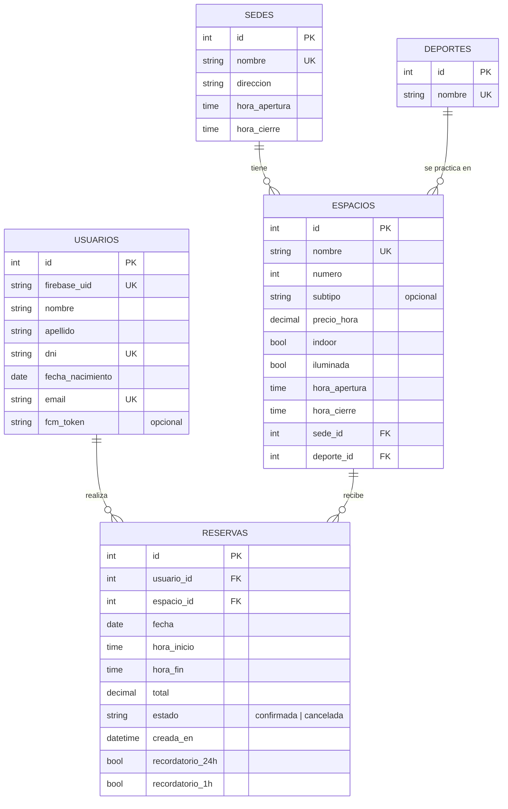

# Modelo de datos

Base de datos PostgreSQL gestionada con SQLAlchemy (`backend/app/models.py`).
Las tablas se crean solas al iniciar la API.

## Relaciones
| Relación | Cardinalidad | Detalle |
|---|---|---|
| Sede → Espacio | 1 a N | Una sede tiene muchas canchas; cada cancha pertenece a una sola sede. |
| Deporte → Espacio | 1 a N | Un deporte se practica en muchas canchas. |
| Usuario → Reserva | 1 a N | Un usuario hace muchas reservas. |
| Espacio → Reserva | 1 a N | Una cancha recibe muchas reservas (en distintos horarios). |

## Tablas
- **sedes**: ubicación y horario general del club en esa sede. Las canchas deben quedar dentro de ese horario (lo valida la API).
- **deportes**: catálogo (Fútbol, Pádel, Tenis, Básquet, Golf).
- **espacios**: las canchas. `subtipo` distingue variantes (Fútbol 5, Cemento, 9 Hoyos…), `precio_hora` es el valor de una hora.
- **usuarios**: perfil de la persona. La contraseña **no** se guarda acá: la gestiona Firebase Authentication y se vincula por `firebase_uid`. `fcm_token` es el dispositivo al que se envían las notificaciones push.
- **reservas**: una reserva dura 1 o 2 horas en hora en punto. `estado` es `confirmada` o `cancelada` (las canceladas se conservan en el historial). `recordatorio_24h` y `recordatorio_1h` evitan enviar dos veces el mismo aviso.

## Reglas de integridad
- `nombre` de sede, deporte y cancha, y `dni`, `email` y `firebase_uid` de usuario son únicos.
- No pueden existir dos reservas confirmadas superpuestas en la misma cancha (la API bloquea la fila de la cancha al reservar, por lo que si dos personas reservan a la vez entra una sola).
- Una sede o deporte con canchas, o una cancha con reservas, no se puede eliminar sin resolver antes esa dependencia.
